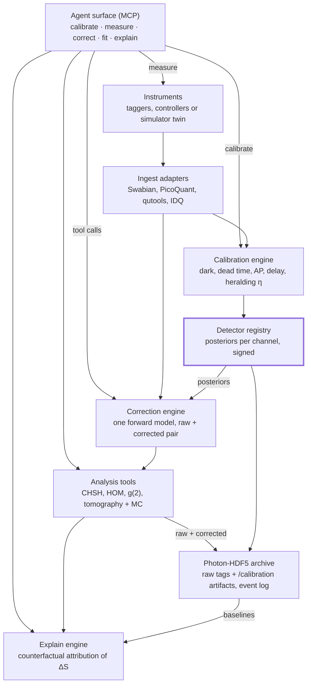

# DADL: Detector-Aware Data Layer for Quantum Optics Experiments — Design Doc

Nov 10, 2026 · @Jeff · revised Nov 11, 2026 after the third review

## Summary

We will build an open-source, vendor-neutral, physics-first library (Python API, Rust core), developed in public on GitHub, designed to keep a living, versioned calibration model for every single-photon detector channel and carry that model's uncertainty into Bell S, visibility and fidelity. An MCP server may later sit on top so agents can call the same validated tools. Status: draft. Phase 1 is partly released (v0.0.3); this doc is the canonical phase plan, and the README and the overview site copy it.

**What users get:** a downloadable starter kit, not a turnkey product. A user installs it, runs the full pipeline on simulated data in minutes, then tests and adjusts adapters, detector models, analyses and guardrail policies to fit their own setup. Everything is built to be read, changed and re-tested.

The positioning is "known, bounded, auditable imperfections", not "cheap detectors become research-grade." Software cannot recover lost efficiency or jitter. In Bell tests and QKD security paths, correcting the data is not allowed at all, so the layer reports raw and corrected values side by side and refuses invalid corrections.

**What works today (v0.0.3).** Everything else in this doc is design, not code.

- A seeded time-tag simulator with injected efficiency, dark counts, non-paralyzable dead time, jitter, delay and one generation of afterpulsing.
- `setup.yaml` drives it: `dadl quickstart`, `dadl init`, `dadl simulate` and `dadl analyze` (raw CHSH S from your own tags in a generic `.npz`/`.csv` format).
- Raw CHSH S from fixed-grid coincidences with a declared window; Bell fringe and HOM dip visibility, with accidental subtraction where the policy allows it.
- Guardrail refusals, policy fingerprints recorded on every result, and threshold labels.
- Statistical (Gaussian) uncertainties only. No calibration fits, no calibration uncertainty, no corrected CHSH, no signing, no adapters, no MCP.
- A Rust core with the same per-tag functions, held to the Python reference by shared test vectors; it is not yet called from Python.

Three design commitments shape everything below:

1. **One generative detector model per channel**, fitted and versioned, instead of a stack of independent subtractions.
2. **Raw is always preserved and reported.** Every corrected number is paired with its raw counterpart and the calibration artifacts it used.
3. **Explanations are numbers first.** Drift explanations come from counterfactual attribution with intervals; any LLM text is rendered from that output, never free-form.

## Background and problem

The physics is solved; the integration is not. Klyshko (correlated-photon) calibration agrees with substitution calibration at NIST to within 0.14(14)%, with uncertainties of 0.18% and 0.17% (k=1), and NIST describes a low-cost substitution procedure targeting 0.5% (k=1). Dead time, afterpulsing and accidentals all have textbook models. The gap is that nobody owns the chain *detector state → correction → uncertainty → result → explanation* across vendors.

| Tool | What it does well | Where it stops |
| --- | --- | --- |
| Swabian Time Tagger | Streaming correlations, virtual channels, multi-tagger merge, replay | No detector models, calibration registry or uncertainty |
| PicoQuant PTU / SymPhoTime | TTTR records, scripting | Fluorescence-oriented, no detector health |
| qutools quTAG | Threshold auto-calibration, coincidence filters | Input threshold only |
| Single Quantum Eos | API bias sweep to a dark-count target | Per-vendor, no link to experiment metrics |
| IDQ ID281 | Autonomous 24/7, latch-free hardware | Closed, device-level only |
| ETA | Fast JIT time-tag analysis across formats | No calibration or uncertainty |
| Kwiat Quantum-Tomography | MLE, accidental/crosstalk correction, MC error bars | No live detector model; accidental correction is just an option |
| Photon-HDF5 | Open HDF5 schema with provenance | Point-value detector fields only; no posteriors, uncertainty or calibration history |
| Qunnect, Aliro | Network automation and orchestration | Polarization and network level; depend on device telemetry |

The biggest technical risk is overcorrection, not missing corrections. Subtracting accidentals can turn a non-violating Bell dataset into a violating one. Data-dependent coincidence windows open the coincidence-time loophole; one NIST and University of Illinois analysis showed a classical source producing an apparent violation of over 2700σ (assuming Gaussian statistics), and none with a predefined fixed window. MLE tomography has been shown to underestimate fidelity and overestimate entanglement, and bootstrapping inherits that bias.

## Goals and non-goals

**Goals**

- Run out of the box: install, then one command runs CHSH, HOM and tomography end to end on simulated data, with no hardware.
- Be easy to adapt: adapters, detector models, analyses and guardrail policies are plug-in points with documented interfaces and worked examples.
- Let users test their own changes: a `validate` command checks a user's adapter, model and configuration against the shared conformance and coverage tests.
- Maintain a versioned, posterior-carrying detector model per channel: efficiency, DCR(T, V), dead time, afterpulse kernel, crosstalk, delay, jitter IRF, latching state.
- Propagate calibration uncertainty into S, visibility, g(2) and fidelity by joint Monte Carlo over nuisance parameters.
- Always report raw and corrected values together, with the calibration artifact IDs used.
- Enforce loophole guardrails per analysis type by refusing rather than warning. Users may loosen a policy, but never silently.
- Explain changes in a result (e.g. ΔS) as counterfactual attributions with intervals.
- Ship reference adapters for Swabian and PicoQuant data, archived as Photon-HDF5 with a `/calibration` extension.
- Expose typed MCP tools with a simulator twin that shares the same surface.

**Non-goals**

- A turnkey, supported product. Users own their configuration or fork; the kit ships defaults, examples and tests, not guarantees for every setup.
- Covering every tagger and detector in the main repo. A few reference adapters ship; users add others from the adapter template.
- Making low-cost detectors "research-grade." Lost efficiency and jitter cannot be recovered.
- Closing the detection loophole in software. CHSH needs about 82.84% efficiency to avoid the fair-sampling assumption (Garg and Mermin, 1987), or about 2/3 with Eberhard's inequality, non-maximally entangled states and near-zero background (Eberhard, 1993). Efficiency correction is equivalent to assuming fair sampling.
- Any correction in a QKD security path. There, the kit offers monitoring and attestation only.
- Replacing time-tagger firmware, lab orchestrators (QCoDeS, ARTIQ, Bluesky) or NMI-traceable calibration.
- Cloud processing of raw time tags. At 10⁷–10⁸ tags/s they stay local.

## Users and use cases

Network testbed operators come first because uptime is their KPI and detector drift is their next unmanaged variable.

| Priority | User | Core use case | What they accept |
| --- | --- | --- | --- |
| 1 | Quantum network testbeds and operators | Always-on detector health; explain fidelity or rate drops on long, lossy links | Telemetry fed into Aliro-style orchestrators |
| 2 | SPDC / Bell / HOM / tomography research labs | Reproducible results with honest error bars; less grad-student time on calibration | Free and open; may contribute analyses and adapters |
| 3 | QKD vendors | ETSI GS QKD 011-style characterization; blinding and latching monitoring records (evidence of what was observed, not proof of security) | Monitoring and attestation only, no corrections |
| 4 | Metrology institutes, detector makers | Reference datasets, validation | Contributors and validators |
| 5 | Remote and teaching labs | Guided calibration and explanation | Secondary |

Representative stories:

- *Operator:* "Fidelity on link 3 fell overnight. Tell me how much of the drop is detector B's dark counts, how much is delay drift, and what's left unexplained."
- *Lab:* "Give me S with error bars that include my efficiency and dead-time uncertainty, and stop me if my window choice opens a loophole."
- *QKD vendor:* "Give me a signed record of detector behaviour during this key-generation session, including any blinding or latching signatures."

## Starter kit

A user should get from download to a full result on simulated data in under 15 minutes, then to their own data by copying the closest example. The project is DADL (tagline: "Detector-Aware Data Layer for quantum optics experiments", also the GitHub repo description); the package and command are `dadl`, short for Detector-Aware Data Layer.

### First run

```bash
pip install dadl-quantum
dadl quickstart chsh-spad
```

**Phase 1 (works today).** `quickstart` loads the example's `setup.yaml`, generates seeded simulated time tags with known imperfections, and prints raw S with its statistical error beside the closed-form expectation. `dadl init` copies the setup into a folder to edit; `dadl quickstart setup.yaml` runs the edited copy; `dadl analyze setup.yaml --tags tags.npz` computes raw S from your own tags.

**Target (phase 2 and later).** `quickstart` also calibrates with fast Laplace posteriors (full NUTS fits opt-in) and prints raw and corrected values with intervals beside the injected truth. The same project then runs on a tagger through an adapter.

### Example setups

Each example is a folder with a config file, a seeded simulation recipe (data is generated at quickstart, not shipped), a notebook and expected outputs, so users can start from the closest match. Hardware replay files are downloaded on demand from release assets with hash checks.

| Example | Setup | Shows |
| --- | --- | --- |
| `chsh-spad` | Polarization-entangled SPDC, four Si SPAD channels, simulator (shipped) | Raw S from a planned fixed window beside the closed-form expectation; calibration and corrected S in phase 2 |
| `hom-snspd` | HOM interference, two SNSPDs, simulator (shipped) | Two-point visibility at the declared delay with an interruption (latch) label; visibility scan fit and SNSPD latching signatures are planned |
| `tomography` | Two-qubit state tomography | MLE vs. Bayesian estimates, low-count bias warnings |
| `link-monitor` | One network link with the health monitor running | Change-point alerts, explain a fidelity drop |
| `cheap-vs-reference` | Same source split between CMOS SPADs and a reference detector | The hardware A/B method from the validation plan (after the MVP: needs CMOS SPAD and crosstalk support) |

### One config file per setup

A single `setup.yaml` describes channels, detector families and serials, the tagger, analyses, the pre-declared coincidence window and the guardrail policy. Users adapt the kit mostly by editing this file, not code. It carries a schema\_version. Phase 1 validates it in code: types, units in key names, unknown and duplicate keys, and a 1 MB size cap. Its structure is published as a JSON Schema, `schema/setup-1.schema.json` (phase 2); a `dadl check-config` command and `dadl migrate` come later in phase 2. Phase 1 accepts only `policy: default`; rules are loosened in code with `Policy.allow(analysis, correction, reason)`. YAML 1.1 reads `1.0e5` as a string, so the loader refuses it; write `100000` or `1.0e+5`.

### Extension points

None of these templates ship in phase 1; the adapter template comes first, in phase 2. Extensions will be registered through Python entry points, so users can add them in their own package without forking. Groups are versioned (e.g. dadl.adapters.v1) under a published stability and deprecation policy, and only plugins listed and hash-pinned in setup.yaml are loaded.

| Extension | How to add one | Template |
| --- | --- | --- |
| Tagger adapter | Implement the adapter contract in Rust, or in Python for SDK-only vendors | `dadl new adapter` |
| Detector family model | Python class giving parameters, priors and likelihood terms | `dadl new detector-model` |
| Analysis | Python function taking a dataset and returning raw and corrected estimates | `dadl new analysis` |
| Guardrail policy | YAML rules per analysis type | Copy a shipped policy |
| Explain parameters | List of nuisance parameters and how to hold each at baseline | Section in `setup.yaml` |
| Telemetry source | Wrapper over a QCoDeS driver or any time-stamped reading | `dadl new telemetry` |

### Testing changes

`dadl validate` lets users check their own changes before trusting a result:

1. **Conformance:** a new adapter passes the shared suite on its recorded replay files.
2. **Coverage:** the user's config is simulated with injected parameters, and 95% intervals must contain the truth about 95% of the time. A fast tier runs in minutes; the full tier (≥1,000 replicates) runs overnight.
3. **Guardrails:** the regression cases still refuse, unless the policy deliberately changed.
4. **Golden outputs:** the examples still reproduce their expected results within tolerance.

The output is a short report saved with the project, so a result can cite the validation run it relied on.

## Architecture

Seven layers share one detector model registry. Every correction, analysis and explanation reads its parameters from the same signed calibration artifacts.



Time tags enter through vendor adapters and feed both the calibration engine and the correction engine. Calibrations update the registry, whose posteriors drive every correction. Paired raw and corrected results land in the archive, which the explain engine compares across runs. Agents reach the system only through the typed MCP tools.

## Detector model and calibration engine

Each channel has one generative model, stored as posterior samples with provenance and refitted from data the experiment already produces. Datasheet values are priors, never truth.

### Model parameters

| Parameter | Model | Primary calibration source | Re-fit trigger |
| --- | --- | --- | --- |
| Efficiency η | In-situ heralded system efficiency (detector × coupling, "as detected" per NIST IR 8486r1); optional Klyshko anchor; detector-only η needs an external reference | SPDC heralding ratio, Beta posterior | Change-point on heralding; connector event |
| Dark count rate | DCR = f(T, V\_ex), Arrhenius generation plus field-dependent tunnelling (SPAD); bias/I\_sw curve plus stray light (SNSPD) | Shuttered or gated dark windows, fitted jointly with afterpulsing | Residual vs. fitted model, not a fixed threshold |
| Dead time | (Phase 2 implements a hard-edge non-paralyzable effective channel dead time only; the series model below is phase 3.) Series model: a paralyzable stage τ\_p then a non-paralyzable stage τ\_np, m = m₁/(1 + m₁(τ\_np − τ\_p)) with m₁ = n·e^(−nτ\_p) for τ\_np > τ\_p; fitted in the time domain together with afterpulsing | Inter-arrival histogram (hard-zero region + recovery) | Rate regime change |
| TDC dead time | Separate term from detector dead time | Tagger config + histogram | Firmware/config change |
| Afterpulse kernel | Excess over exponential Poisson tail; "well-defined initial condition" method | Autocorrelation / inter-arrival histogram; double-window for gated InGaAs | Temperature or bias change |
| Crosstalk matrix | Branching (geometric/Borel) or nearest-neighbour; Si SPAD breakdown-flash peaks at a fitted nonzero delay | Dark-only zero-delay correlations between pixels | Overvoltage change |
| Delay and jitter IRF | Peak position; convolved detector + TDC + cable IRF | SPDC cross-correlation peak; for Bell-type runs, frozen from a separate calibration segment before analysis | Continuous tracking |
| Latching / blinding state | Signature rules, ingested reset events | Controller telemetry, count vs. bias current | Any signature hit |

### Detector families

The model is parameterized per family because the dominant imperfection differs:

- **Si SPAD modules** (e.g. Excelitas SPCM-AQRH): 25–1500 cps dark grades, \~22–42 ns dead time (individually non-paralyzable apart from twilight counts), \~0.5–1% afterpulsing. Watch DCR(T), afterpulsing, efficiency vs. rate.
- **CMOS SPADs**: dead time from ns to µs with passive quench, afterpulsing from a few % to 25–30%. Watch DCR(T, V), afterpulsing, crosstalk map.
- **SiPMs**: crosstalk \~25% for bare devices at high bias, rising to \~40–49% with reflective packaging; kHz–MHz dark rates. Crosstalk creates fake zero-delay coincidences, so it is always a separate reported term.
- **SNSPDs**: dark counts as low as <1 cps (band-dependent maximum <5 to <100 cps), stray-light dominated, negligible afterpulsing, latching risk. Watch bias/I\_sw drift, latching, cryostat temperature.

### Calibration scheduling

Routines run on a schedule and on triggers. Triggers come from change-point detection (CUSUM or Bayesian online change-point) on heralding efficiency, model residuals, and connector or config events. Each run emits a signed, immutable calibration artifact; a new artifact supersedes but never overwrites the old one. Fiber-connector reconnection is logged as its own uncertainty component, since it often dominates the budget for fiber-coupled detectors.

Known pitfalls the engine must model: Klyshko overestimates η as pump power rises (multi-photon SPDC); SPAD intrinsic efficiency can depend on detection rate; inter-arrival afterpulse estimates depend on the detector's prior state.

## Correction, inference and uncertainty

Corrections come from one forward model and likelihood-based inference, not chained subtractions. Chained subtractions double-count overlapping events, for example afterpulses also being counted as accidentals.

### Forward model

For each channel, the model maps true photon arrivals to recorded tags as a self-exciting process: loss (η\_sys), dark counts, jitter and delay, with every recorded avalanche triggering dead time (detector, then TDC), afterpulsing and crosstalk. For photon-number statistics, the distortion takes the form p\_measured = M\_ct · M\_dark · M\_loss · p\_true. It is **fitted, never inverted**, because inversion produces non-physical results.

### Accidentals

Accidentals are estimated empirically from off-peak delay bins (the same histogram shifted by many window widths). For pulsed pumps, the off-peak bins are the side peaks at multiples of the repetition period. R1·R2·Δt is a cross-check only, since it assumes stationarity and ignores afterpulse and crosstalk structure.

### Uncertainty propagation

| Layer | Method |
| --- | --- |
| Counts | Poisson; delta method when counts are large |
| Heralded ratios, low-count bins | Exact or Bayesian intervals (Clopper–Pearson, Beta posterior) |
| Calibration nuisance parameters | Joint Monte Carlo from calibration posteriors, pushed through the full analysis |
| Bell S | Multinomial resampling per setting; the raw interval reported against S = 2 (a Gaussian σ count is not a significance claim, as the 2700σ example shows); CH/Eberhard plus test-martingale or p-value for loophole-relevant claims |
| Tomography | MLE with bias warnings; profile likelihood, Faist–Renner MCMC error bars, Bayesian mean, or direct fidelity estimation |

Joint Monte Carlo is the only practical way to carry calibration uncertainty into S, visibility and fidelity, because they are non-linear and share inputs.

### Tomography bias

MLE enforces positivity, which has been shown to underestimate fidelity and overestimate entanglement (Schwemmer et al., 2015) and to bias purity (Silva et al.). A non-parametric bootstrap inherits the same bias, and a parametric bootstrap applies it a second time. The tool warns when counts per setting are low (MLE effects were negligible above \~10⁴ counts per setting in one Sagnac-source study's simulation of a near-ideal Bell state) and offers a bias-aware estimator. The MVP wraps the Kwiat library and pins v1.2.1 or later, which includes its Monte Carlo error-bar fix (v1.0.8) and accidental-correction fixes (v1.2.0).

## Scientific guardrails

Guardrails are enforced in the library, not in prompts: an invalid correction is refused with a typed error, whoever calls it. The analysis type is fixed by the function called (`bell_visibility`, `hom_visibility`, `chsh`), never passed in by the caller, so data cannot be filed under a looser rule. Each analysis type declares which corrections it allows in its headline number.

| Analysis | Headline number allows | Refused or flagged |
| --- | --- | --- |
| Bell / CHSH / CH-Eberhard | Raw counts only; fixed, clock-locked window computed from raw tags in the core and declared in the analysis plan; coincidence-normalized S labelled "fair sampling assumed" | Accidental subtraction in headline S; data-dependent or event-centred windows; efficiency correction presented as loophole-free |
| QKD security path | Nothing; monitoring records only, against a baseline frozen before the key session (no recalibration or drift updates during it) | Any correction of key-relevant data |
| HOM visibility, g(2) | Raw headline; off-peak accidental and afterpulse corrections shown as labelled secondary values | Same-detector correction without an afterpulse model; ignoring crosstalk or breakdown flash; single-detector g(2) at \|t\| below dead time; background-corrected headline for purity or indistinguishability claims; vendor event-centred coincidence modes |
| Tomography | MLE or Bayesian, with bias warnings | Bootstrap error bars presented as unbiased at low counts; accidental-subtracted values in the headline of an entanglement claim |

Rules that apply everywhere:

1. **Raw and corrected always paired.** No API returns a corrected value without its raw value and the artifact IDs used.
2. **Windows are pre-registered.** The coincidence window and how it was chosen are recorded before analysis. A window derived from the same data is rejected for Bell-type analyses.
3. **Single model, no double counting.** Overlapping corrections must come from the forward model; stacking independent subtractions is refused.
4. **Fair-sampling stated.** Any efficiency correction carries an explicit "assumes fair sampling" label. The tool states that CHSH needs \~82.84% efficiency (\~87.87% to also avoid fair coincidence) and that low-cost SPADs cannot meet it.
5. **Distinguishability stated.** The tool says what it cannot separate, for example source-brightness drop vs. coupling loss without a heralding check.

**Adjustable, never silent.** Because this is a starter kit, users can change the guardrails. In phase 1, loosening goes through `Policy.allow(analysis, correction, reason)`, which needs a written reason; building a policy with looser rules directly is refused, and the shipped rule tables are read-only. Every result records the policy fingerprint (a hash of the rules and thresholds, compared against a pinned constant) and the overrides with their reasons, and any non-default policy is labelled "policy modified" next to the raw value. Policy files, human approval tokens and keeping agents from writing policy arrive with the MCP surface. The shipped defaults stay strict.

**What phase 1 cannot check.** The window's `source: plan` is declared by the caller and recorded, not verified; signed analysis plans (phase 3) close that gap. The counts and tags passed in are trusted as given; dataset IDs computed from raw tags (phase 2) close that one. A result is protected against accidents, not forgery: code in the same process can always build or edit one.

**Rules added after the second review:**

- **Analysis-plan ledger.** Analysis type, window, sample size, stopping rule and data-exclusion rules are signed into an append-only ledger before the first acquisition. Every result reports how many runs, windows and artifact sets were tried under that plan. Bell results across runs are combined with a test martingale or a trial-corrected p-value, never best-of-N.
- **Threshold crossings.** Each analysis type knows its physical thresholds (S = 2; two-photon fringe visibility 1/√2 ≈ 71%, which implies S > 2 only for a Werner state with that visibility in both the H/V and the diagonal basis; HOM dip visibility 50%; fidelity 0.5; zero concurrence). If only the corrected value crosses one, the headline is refused or labelled "threshold crossed only after correction", with the raw interval first. Values within 1.96σ of a threshold, and results whose Gaussian error is zero at a boundary, carry their own labels (implemented in 0.0.3).
- **Bell timing.** Delay and window position for Bell-type runs come from a separate calibration segment, frozen before analysis, with a stated drift limit.
- **Calibration choice.** An artifact whose time range or conditions don't bracket the dataset is refused unless overridden, which labels the result "policy modified".
- **Data exclusion.** Exclusion rules come from the plan and use setting-blind telemetry only. Results report the excluded fraction and the estimate on all data.
- **Third-party analyses.** Analyses loaded from plugins get the strictest policy and an "unvalidated analysis" label.
- **Labels travel with numbers.** Results are a value type that is not implicitly convertible to a float; a bare number takes an explicit `.raw.value`. This guards against accidents, not forgery. Exports carry label columns, plots are annotated automatically, and `dadl report` produces a citable headline block with raw first, all labels and the plan-ledger ID.
- **QKD sessions.** No recalibration or drift update runs during a key session. Signatures are checked against fixed physical floors and ceilings at sub-second resolution, and any change-point during the session voids its monitoring record.

## Explain engine

An explanation is only emitted after the engine has proved its share of the change numerically. Something like "S dropped from 2.6 to 2.3 because detector B's dark counts tripled" is the right shape, but it is often false. Accidentals scale S as S = 2√2·V·C/(C + A) with V ≤ 1, so a baseline of S = 2.6 already forces A/C ≤ 0.088, and reaching 2.3 needs A/C to rise to 0.230 (×2.6). Even if every baseline accidental came from B's dark counts, a 40% rise in DCR\_B only takes S to about 2.52. Tripling DCR\_B does reach 2.3, but only if B's dark-count accidentals were already about 0.071·C (about 80% of all accidentals), roughly when DCR\_B·Δt ≈ 0.07·η\_B, as on long, lossy links.

### Counterfactual attribution

1. Pick a baseline run and a current run, each with its calibration artifacts. The baseline choice is recorded with a reason, and the parameter set defaults to all groups.
2. Re-run the analysis with each nuisance parameter (DCR\_B, η\_A, delay, polarization drift, pump power) held at its baseline value, using grouped Shapley attribution over identifiable parameter groups, with joint posterior draws from both runs. Collinear groups (e.g. system efficiency vs. pump power without a heralding check) are reported as "cannot distinguish", never split.
3. Attribute ΔS to each parameter with Monte Carlo intervals, plus an explicit misfit term: the observed ΔS minus the model-predicted ΔS, with its own interval (the observed ΔS carries shot noise of about √2·σ\_S from the two runs).
4. Render text from that table only, through fixed sentence templates. Causal wording is suppressed when a group's 95% interval, adjusted for the number of groups (Holm or false-discovery-rate), includes zero, and the misfit term and "cannot distinguish" list always come first. Every sentence cites its share, e.g. "0.21 ± 0.04 of the 0.30 drop."

### Supporting analytics

- Physics-model residuals: DCR vs. fitted T-dependence; efficiency vs. heralding baseline.
- Change-point detection on heralding efficiency to catch connector events and fiber reconnections.
- Cross-correlation with environment: room and cryostat-stage temperature, humidity, pump power.
- Delay-peak tracking for cable and temperature drift.
- Signature rules for latching and blinding: count rate collapsing while bias current rises; afterpulse and dark statistics vanishing; coincidences between detectors that should be exclusive.

### Output contract

Every explanation includes raw vs. corrected values, the residual plots, attributions as numbers with intervals, links to calibration artifacts and raw-data hashes, and a "cannot distinguish" list. The LLM renderer gets the attribution JSON as its only input, and a checker rejects any number in the text that is not in that JSON.

## Agent and MCP surface

Agents call deterministic, validated physics tools. They never compute corrections in-context. The MCP server exposes five typed tools in three permission tiers.

| Tool | Does | Side effects | Approval |
| --- | --- | --- | --- |
| `calibrate` | Runs a calibration routine (dark window, inter-arrival fit, delay/jitter, heralding efficiency, Klyshko) and emits an artifact | Writes a new artifact to the registry; may shutter, change gating or bias | Human approval for changes the signed site config marks hazardous (e.g. bias near I\_sw, laser power near blinding levels) |
| `measure` | Acquires or replays time tags for a declared analysis and window | Instrument acquisition | Required when it writes instrument settings |
| `correct` | Applies the forward model to a dataset; returns raw + corrected + artifact IDs | None | None; guardrails refuse invalid requests |
| `fit` | S/CHSH/CH-Eberhard, HOM visibility, g(2), tomography with intervals | None | None |
| `explain` | Counterfactual attribution between two runs; optional text rendering | None | None |

Safety design:

- **Schema-bound inputs.** Arguments are validated at the boundary with typed limits; invalid ones fail with auditable errors that don't depend on prompt phrasing.
- **Permission tiers.** Pure compute (correct, fit, explain) needs no capability. Registry writes (the artifact calibrate creates) need one. Instrument writes (bias, gating, laser, acquisition settings) need one plus a human approval token when hazardous.
- **Audit log.** Every call, argument, approval and returned artifact ID is appended to a tamper-evident log.
- **Simulator twin.** A physics-plausible simulator exposes the identical tool surface, so agents and CI run offline against injected imperfections.
- **Interop.** Instrument writes go through QCoDeS drivers (via InstrMCP-style bridges) where possible, following LabMCP-style patterns for limits and read-only modes.

## Data model, storage and provenance

Photon-HDF5 is the interchange container. DADL writes its calibration data under `/user/dadl_calibration`, the spec's extension point, and proposes a `/calibration` group upstream instead of inventing a new format; paths below are relative to that group. It also fills the native point-value fields under `/setup/detectors` with posterior medians in SI units, and sets `timestamps_unit` = 1e-12 s for its int64 ps tags. All three are to be checked against the spec and phconvert's validator in phase 2. Raw tags stay on-prem; the project runs no hosted service.

```
/photon_data      timestamps (typically int64), timestamps_specs/timestamps_unit, detector IDs   [existing]
/setup            detectors, tagger, optics                         [existing]
/sample           sample description                                [existing]
/identity         file and author identity                          [existing]
/provenance       source files, software                            [existing]
/user/dadl_calibration   [new; proposed upstream as /calibration]
  /artifacts/<id> method, timestamp, raw-data hashes, posterior samples, signature
  /channels/<ch>  current artifact ID per kind (parameters fitted jointly share one artifact)
  /events         connector reseats, config changes, latch resets, change-points
  /analysis       window + how chosen, corrections applied in order, raw + corrected
```

### Calibration artifacts

Artifacts are immutable and content-addressed; signing is planned (see "Signing" below). Each holds the method, input data hashes, posterior samples, software versions and the artifact it supersedes. Results reference artifact IDs, never copied parameter values, so any number can be traced back and recomputed.

### Minimum metadata for reproducibility

- Detector serial, type, bias/overvoltage, temperature.
- Time-tagger model, firmware, trigger levels, input delays, dead-time filter settings.
- Coincidence window and how it was chosen (pre-registered).
- Calibration artifact IDs, the connector-event log.
- Software versions, including the tomography library version.
- Corrections applied, in order, with raw values preserved.

### Ingest adapters

Swabian (binary dumps, live API, virtual tagger replay), PicoQuant PTU (DADL's own T2 reader, cross-checked against ptufile), qutools, IDQ, ETA-readable files, and SNSPD controller telemetry through QCoDeS drivers. All normalize to an internal event stream plus the Photon-HDF5 archive. Heavy lifting at 10⁷–10⁸ tags/s stays in vendor engines or the Rust core.

## Detailed architecture

These subsections turn the layer design into buildable contracts. Figures marked "target" are proposals to validate during phase 1, not measurements.

### Runtime and throughput

No per-tag loop ever runs in Python. The Rust core owns every per-tag loop; Python orchestrates, fits and reports on reduced data (histograms, counts, posteriors).

| Layer | Language | Works on |
| --- | --- | --- |
| Adapters, event stream, online statistics | Rust | Raw tag batches |
| Histogramming, off-peak accidentals, delay-peak tracking, change-point | Rust | Raw tags → histograms |
| Model fitting, Monte Carlo, analyses, explain | Python (NumPy/SciPy, JAX optional) over Rust kernels | Histograms and counts |
| MCP server, CLI | Python | Artifacts and results |

Batches cross the Rust–Python boundary as Apache Arrow record batches (`timestamp: i64` in ps, `channel: u16`) through PyO3, with no copy. Python sees NumPy views, never per-tag objects. Zero-copy holds for null-free, single-chunk, fixed-width columns; anything else is copied once.

**Two data paths.** At 10⁸ tags/s, packed tags are about 1 GB/s, roughly 3.6 TB/hour, so continuous raw archiving is not an option.

- **Hot path (always on):** the vendor engine or the Rust core reduces the stream to per-channel singles, rolling correlation histograms, inter-arrival histograms and delay-peak positions. Only these reach the registry and monitor.
- **Cold path (on demand):** raw tags are written to Photon-HDF5 only for calibration windows and declared acquisitions, each with a hash recorded in its artifact.

Where a vendor engine already computes a correlation (e.g. Swabian Coincidences or Correlation), the adapter consumes its histogram instead of recomputing it, and records the vendor's settings as provenance.

Targets: hot path keeps up with 10⁷ tags/s per core in Rust (10⁸ tags/s is the multi-core stress case); Python SDK adapters are a lower tier at 10⁶ tags/s; health metrics update at least once per second; a calibration fit finishes within a minute on a lab PC.

### Adapter contract

In-tree adapters implement one Rust trait. Python-only vendor SDKs implement an equivalent Python Protocol, wrapped by a PyAdapter shim in the core, and form a lower-throughput tier. Out-of-tree Rust adapters ship as their own wheels and hand data to the core through the Arrow C Stream interface, since Rust has no stable ABI. Capabilities are declared, not assumed, so the core knows which work to push to the vendor engine.

```rust
trait Adapter {
    fn describe(&self) -> DeviceInfo;            // model, serial, firmware, channels, timestamp resolution
    fn capabilities(&self) -> Capabilities;      // live, replay, vendor histograms, settable delays, gating
    fn config(&self) -> TaggerConfig;            // trigger levels, input delays, dead-time filters (provenance)
    fn open_stream(&mut self, req: StreamRequest) -> Result<TagStream>;   // Arrow batches, monotonic per channel
    fn vendor_histogram(&mut self, spec: HistSpec) -> Result<Option<Histogram>>;
    fn apply(&mut self, change: ConfigChange, approval: Option<ApprovalToken>) -> Result<ConfigEvent>;
}
```

Rules every adapter must meet:

- Timestamps are converted to i64 ps on a declared clock; overflow and rollover are handled in the adapter.
- Every config change, buffer overflow or dropped batch becomes a typed event in `/calibration/events`. Silent drops are a test failure.
- `apply` refuses writes without an approval token when the change is marked hazardous.
- Each adapter ships recorded replay files and passes the shared conformance suite in CI, so it can be tested without hardware.

Detector controllers (SNSPD bias, cryostat temperature, SPAD module temperature) use a separate `TelemetrySource` trait that emits time-stamped readings and reset or latch events, typically through QCoDeS drivers.

### Forward model specification

Each channel is modelled as a self-exciting point process, and parameters are grouped so that each is identifiable from data the kit actually takes. Parameters the data cannot separate are fitted as their product, never split by priors.

| Group | Parameters | Identified by |
| --- | --- | --- |
| Arm, per channel | System efficiency η\_sys = η\_det × t\_arm (detector × coupling, filters, connectors). Detector-only η\_det only with an external reference (substitution or swap test) | Heralding ratio with a pump-power scan |
| Detector, per channel | DCR(T, V): Arrhenius generation plus a field-dependent tunnelling term; dead times τ\_np and τ\_p; afterpulse kernel (sum of exponentials, ordered time constants); crosstalk kernel at a fitted offset, including breakdown-flash peaks at 2n\_g·L/c (n\_g ≈ 1.47 in fibre, about 10 ns per metre); delay; IRF (Gaussian core plus exponential tail); latch state | Dark inter-arrival data (DCR and afterpulsing fitted jointly); cross-correlation peaks |
| Tagger, per channel | TDC dead time; input delay; trigger level (recorded, not fitted) | Config and inter-arrival histogram |
| Source, per setup | Pair rate N; multi-pair term; polarization or basis-mixing parameters | Rate-dependent coincidence-to-accidental ratio, pump-power scan |

**Detection process.** Every recorded avalanche (photon, dark count, afterpulse or crosstalk) starts a dead time. Afterpulse and crosstalk kernels are triggered by recorded avalanches and conditioned on recovery, so they cascade. The kit simulates and fits this in the time domain. Where singles need a closed form, it uses the exact series model, a paralyzable stage followed by a non-paralyzable one (τ\_np > τ\_p):

```latex
m = \frac{m_1}{1 + m_1(\tau_{np} - \tau_p)}, \qquad m_1 = n\, e^{-n\tau_p}
```

The empirical hybrid m = n·e^(−nτ\_p)/(1 + nτ\_np) (Patil and Usman) is not this model: it is up to about 30% low against a simulated chain at high rate, so it is never used as a test oracle. The test suite checks the exact form against a simulated chain to 2%.

**Correlation histogram.** For delay t = t\_b − t\_a, integrated over each bin B\_k:

```latex
\mu_{ab}(k) = \int_{B_k} \Big[ N T\,\eta_a \eta_b \,\big(h * (\mathrm{IRF}_b \star \mathrm{IRF}_a) * (\delta + a_{ab})\big)(t - d_{ab}) + X_{ab}(t) \Big]\, dt + \hat{A}_{ab}(k)
```

Here ⋆ is cross-correlation (IRF\_b convolved with IRF\_a reversed), d\_ab the relative delay, a\_ab the afterpulse kernel carried along the pair peak, and X\_ab the IRF-smeared crosstalk kernel at its fitted offset. Â\_ab is the empirical off-peak accidental estimate: flat for CW pumps, a pulse train at the repetition period for pulsed pumps.

**Likelihood.** Histogram bins and singles are Poisson given μ; heralded ratios are binomial. The same likelihood serves calibration fits, corrections and analyses, which is what prevents double counting.

**Joint posteriors and data reuse.** Parameters fitted from the same data are stored as one joint posterior with a shared sample index and always drawn together (e.g. DCR, afterpulse kernel and dead time from one inter-arrival histogram; η\_sys and N from one heralding run). Calibration data is kept disjoint from analysis data. When that is impossible, nuisance parameters and the metric are fitted in one likelihood.

**Inference.**

- Calibration fits store a fixed number of posterior samples per artifact (target 2,000). Phase 2 uses maximum likelihood with SciPy: exact conjugate posteriors where they exist (Beta for heralding ratios, Gamma for Poisson rates) and Laplace posteriors in log or logit coordinates otherwise. MCMC (NUTS) arrives with the joint model in phase 3; the probabilistic-programming library (NumPyro, PyMC or Stan) is chosen then, after an install benchmark on Windows.
- Between calibrations, drift is tracked by a state-space filter with explicit process noise per parameter, in logit or log coordinates, so uncertainty grows with time since the last calibration instead of shrinking.
- Every filter state used in a correction is snapshotted as an artifact. Data is never corrected with parameters updated from that same data.
- An artifact is accepted only after posterior predictive checks pass on held-out bins; otherwise the previous artifact stays current. (Phase 2: the check runs on the fitted bins, a failure (p < 0.001) sets `checks.status: misfit`, and the CLI refuses to write a misfit unless `--accept-misfit` is given.) A prior-sensitivity check in CI flags any parameter whose posterior is mostly prior.

### Calibration artifact format

An artifact is a small JSON manifest plus a posterior sample table, addressed by the SHA-256 of its canonical manifest. It is stored under `/calibration/artifacts/<id>` and can also live as a standalone file.

The example below is `schema/examples/calibration-dark-afterpulse-deadtime.json`, which CI validates against the schema (`calibration/1`, a draft until every phase 2 calibration writes artifacts; `dadl calibrate dark` already does):

```json
{
  "schema": "calibration/1",
  "kind": "dark-afterpulse-deadtime",
  "channels": [
    {
      "device": "SPCM-0001",
      "input": 3
    }
  ],
  "method": {
    "name": "interarrival-wdic",
    "version": "0.4.0"
  },
  "created": "2026-11-10T14:02:11Z",
  "valid_for": {
    "from": "2026-11-10T14:02:11Z",
    "to": "2026-11-17T14:02:11Z",
    "conditions": {
      "temperature_K": [
        247.0,
        249.0
      ]
    }
  },
  "backend": "hardware",
  "inputs": [
    {
      "sha256": "7dc8f636e5a33428acfe8789ca42bb44342bba3873b4caf65c7ca3e894f3ff2a",
      "role": "raw-tags"
    },
    {
      "sha256": "16091175048ac6014be4712b1640c0e3a3272f4fc944e0bee3248f8861b234be",
      "role": "telemetry"
    }
  ],
  "conditions": {
    "temperature_K": 248.1,
    "bias_V": 2.5
  },
  "posterior": {
    "format": "npy",
    "sha256": "00ff6f13379089e601cac18e06329d5376881931a6832f6f26b29f8d0253c391",
    "n_samples": 2000,
    "params": [
      "dcr_cps",
      "tau_np_ps",
      "p_ap",
      "tau_ap1_ps",
      "tau_ap2_ps",
      "w_ap1"
    ]
  },
  "checks": {
    "converged": true,
    "ppc_pvalue": 0.41
  },
  "supersedes": "6da0633528deaa0144e7b058315f0b753ec0b945163a72bf96a0d18180f9de0d",
  "software": {
    "dadl": "0.4.0"
  },
  "signature": {
    "alg": "ed25519",
    "key_id": "<site key id>",
    "sig": "<base64url signature>"
  }
}
```

Size: 2,000 samples × \~20 parameters × 8 bytes is about 320 kB per artifact, small enough to keep every artifact indefinitely.

**Supersession.** Artifacts form a per-channel, per-kind chain through `supersedes`. The current artifact is a pointer in `/calibration/channels/<ch>`, so a result can always cite the exact artifact used, even after newer ones exist.

**Schema versions.** The kit reads every past schema version indefinitely. Upgrades create new artifacts that link back to the old ones, so existing hashes and signatures stay valid.

**Content addressing (phase 2–3).** The ID is the SHA-256 of the manifest canonicalized with RFC 8785 (JCS). Cross-language test vectors (manifest, JCS bytes, ID) ship with the schema. The posterior hash covers a canonical layout (little-endian float64 columns in `params` order), not Arrow file bytes; input hashes cover datasets, not container files, so writing calibration into the same HDF5 file does not change them. `dadl verify` checks that a recomputed artifact agrees statistically, since MCMC output is not bit-reproducible.

**Signing (deferred to v0.2+).** Until a user needs attestation, artifacts are content-addressed only. The planned design: the signed payload is `"dadl-calibration-v1\0"` followed by the JCS bytes; `sig` is base64url; `key_id` is the SHA-256 of the public key; a per-chain `seq` counter rejects rollback; and small labs can sign with minisign or SSH signatures against an `allowed_signers`-style trust file instead of a keystore or HSM. Each site holds its own key; the project never holds lab keys. Key custody for QKD attestation stays an open question.

### MCP tool schemas

Each tool takes a typed input and returns a typed result that always carries artifact IDs and an audit-log entry ID. JSON Schemas are generated from the Python types, so the library API and the MCP surface cannot drift apart.

| Tool | Key inputs | Returns |
| --- | --- | --- |
| `calibrate` | `channel`, `kind`, `method`, `duration_s`, `limits` (max bias, max laser power), `approval_token?` | New artifact ID, fit checks, the previous artifact ID it supersedes |
| `measure` | `channels`, `analysis_type`, `window` (width + how chosen, declared up front), `duration_s` or `replay_dataset_id` | Dataset ID, raw-data hash, recorded tagger config |
| `correct` | `dataset_id`, `corrections[]`, `artifact_ids?` (defaults to current; non-current artifacts are flagged and logged) | Raw and corrected values side by side, artifact IDs, refused corrections with reasons |
| `fit` | `dataset_id`, `analysis` (chsh, hom, tomography in the MVP; ch\_eberhard and g2 after it), `estimator`, `mc_samples` | Raw and corrected estimates with intervals, warnings (low counts, MLE bias) |
| `explain` | `baseline_id`, `current_id`, `metric`, `parameters?` | Attribution table with intervals and residual, "cannot distinguish" list, optional rendered text |

Typed errors, the same in the library and over MCP:

| Error | Raised when |
| --- | --- |
| `GuardrailRefusal` | A correction or window is invalid for the analysis type |
| `ApprovalRequired` | A hazardous write has no valid approval token |
| `LimitExceeded` | A requested setting is outside configured limits |
| `StaleCalibration` | The current artifact is older than its policy or a change-point has fired since |
| `InsufficientCounts` | Counts per setting are below the estimator's validity threshold |
| `Misspecified` | Posterior predictive checks fail |

**Approval flow.** A hazardous call returns `ApprovalRequired` with a short-lived challenge describing the exact change. A human approves it through an OS-level prompt or passkey that the agent's tools cannot reach. That mints a single-use token bound to the nonce, change hash, session, device and expiry. The agent retries with the token. Tokens never pass through the model's prompt as free text the model could alter, and every step is written to the audit log.

### Security design

The kit drives real hardware and signs evidence, so its safety controls run in core code and read files that agents cannot write.

| Area | Design |
| --- | --- |
| Hardware limits | Hard limits and hazardous-change rules live in a signed site config. Checks use absolute target values, rate limits and cumulative-change tracking, and a watchdog reverts to safe settings. Hardware interlocks and vendor current or power limits are still required. |
| Approval | Needs a human factor the agent's tools cannot reach. The local approval page rejects cross-origin and DNS-rebinding requests and shows the change rendered from the canonical change object beside current values and limits. Device state is re-checked at apply. |
| Where checks run | Approval, limits, guardrails and raw/corrected pairing run in core code, outside plugins. Only plugins listed and hash-pinned in setup.yaml load, and their hashes go into provenance. Vendor SDK adapters can run in a separate low-privilege process. |
| Audit log | Hash-chained, signed and append-only, with sequence numbers and periodic signed checkpoints sent off-host. A separate writer process owns it; `dadl verify-log` checks the chain. |
| Keys | Site keys live in the OS keystore, a TPM or an HSM, used only by a separate signer process. Manifests are canonicalized with RFC 8785 (JCS). A site trust file maps key IDs to identities, validity periods and revocations. Quickstart creates a key labelled "unverified local dev key". |
| Artifact chains | Each per-channel head is signed with a monotonic counter, so forks and rollbacks are rejected. `dadl verify` recomputes an artifact from its hashed inputs and re-runs its checks; artifacts that cannot be recomputed are labelled unverifiable. |
| Prompt injection | Tool results return structured fields. Free text from files, telemetry and other nodes is escaped and marked untrusted. Replays are referenced by dataset ID, never by file path. |
| Network surfaces | Metrics and non-stdio MCP bind to localhost by default; remote access needs mTLS or bearer auth. Security-relevant series such as blinding alarms can be delayed or withheld. |
| Resource limits | Schema maximums and per-session quotas on duration, Monte Carlo samples and explain parameters. Every result and artifact carries `backend: sim` or `hardware`, and hardware access needs its own capability. |
| Supply chain | Trusted Publishing to PyPI from a build job with no publishing permission, PEP 740 attestations, GitHub Actions pinned by SHA and updated by Dependabot, a release check that the tag matches both versions and sits on main, branch and tag protection with 2FA, and maintainer review for guardrail code (two approvals once there are two maintainers). crates.io is published by hand until its Trusted Publishing is configured. |

**QKD monitoring records are not proof of security.** They show what the monitor observed; the absence of a known signature does not prove the absence of an attack. Stronger attestation would need a hardware root of trust, trusted timestamps (RFC 3161) and independent evaluation, which are out of scope.

### Deployment

The kit runs on a single lab PC out of the box. The multi-site setup ships as the link-monitor example, a starting configuration for users to adapt, not a managed deployment.

|  | Single lab PC | Multi-site testbed |
| --- | --- | --- |
| Processes | Library in the user's notebook or script; MCP server over stdio when an agent is used | One `monitor` daemon per node attached to its tagger and controllers; MCP server per node or per site |
| Registry | Local Photon-HDF5 files plus an artifact directory | Per-node artifact store; artifacts replicated to a site store (manifests and posteriors only, never raw tags) |
| Alerts | Printed warnings and the CLI | Metrics endpoint (Prometheus/OpenTelemetry) that orchestrators such as Aliro can scrape |
| Keys | One site key on the PC | One key per node, registered with the site |

**Health monitor daemon.** It runs the hot path continuously and owns these jobs:

1. Track singles, dark windows (shuttered, gated or off-peak bins) and delay peaks per channel.
2. Compare each against the current model and run change-point detection on heralding efficiency and residuals.
3. Evaluate latching and blinding signature rules on every update, raising them immediately.
4. When a trigger fires, mark the affected artifacts stale and schedule a recalibration. Calibrations that only read the instrument run automatically; ones that change bias or gating wait for approval. No recalibration runs during a QKD key session.
5. Export metrics with the current artifact IDs attached, so a downstream alert always points to evidence.

### Explain engine cost

Attribution is affordable for CHSH and visibility, but tomography needs a cheaper estimator inside the loop. Every re-analysis runs on histograms and counts from the two runs, never on raw tags.

Exact Shapley attribution over K parameters needs 2^K re-analyses, each repeated over M Monte Carlo samples. With K = 6 and M = 500 that is 64 × 500 = 32,000 evaluations.

| Metric | Est. cost per evaluation | Est. total at K = 6, M = 500 | Approach |
| --- | --- | --- | --- |
| CHSH S, HOM visibility | \~1 ms | \~30 s | Exact Shapley |
| Fidelity via MLE tomography | \~50 ms | \~27 min | Linear-inversion or direct fidelity estimator inside the loop; MLE only to confirm the top contributors |

Above K = 8, the engine switches to sampled-permutation Shapley with a fixed budget and reports the extra sampling error in the intervals. Per-evaluation costs are estimates to benchmark in phase 4.

## MVP scope and milestones

The team is small, so the MVP is cut to what it can sustain: the `chsh-spad` and `hom-snspd` examples on one tagger, the calibrations they need, and an honest starter kit. Everything else is "v0.2+ / seeking contributors". This section is the canonical phase plan; the README and the overview site copy it.

| Area | In MVP | v0.2+ / seeking contributors |
| --- | --- | --- |
| Time taggers | One (PicoQuant PTU, T2 mode), plus the generic `.npz`/`.csv` tag format and an adapter template | Swabian, qutools, IDQ ID1000; PTU T3 mode |
| Detectors | Si SPAD modules; one SNSPD system | CMOS SPAD arrays, SiPMs (crosstalk maps) |
| Calibrations | DCR(T), dead time, afterpulse, delay/jitter, heralding efficiency, off-peak accidentals | Full Klyshko protocol, crosstalk matrix, rate-dependent η |
| Analyses | CHSH, HOM visibility | Tomography, CH/Eberhard with test martingales, g(2) |
| Storage | Content-addressed artifacts (SHA-256 of JCS), Photon-HDF5 export under `/user` | Signing, shared calibration registry, fleet dashboards |
| Explain, agents | None | Explain engine, MCP server with approval tokens, hash-chained audit log, HSM/TPM signer, QKD attestation, monitor daemon, Arrow C Stream adapters, plugin hash pinning |

Proposed sequence. Each phase gates the next, and each gate is a named CI job with numbers.

| Phase | Delivers | Gate (CI job) | Status |
| --- | --- | --- | --- |
| 1. Simulator and starter kit | Simulator; YAML-driven quickstart; own-data `analyze`; guardrails with recorded provenance; Rust core held to shared vectors | `pytest` closed-form tests (CHSH with accidentals, dead time, exact series dead time) and the 200-seed pull test (pull SD in [0.85, 1.15], mean within 0.25) | Partial (v0.0.3): afterpulse closed-form test and crosstalk simulation outstanding |
| 2. Calibration engine and data model | Dataset/TagSet and ChannelId types; DetectorModel protocol; six calibrations on simulated data and PTU files; PyO3 bindings crate; `setup-1` JSON Schema; adapter template; hom-snspd example; Wilson/Beta intervals; SeedSequence streams | `coverage`: 1,000 replicates per calibration and regime (dark: Si SPAD, CMOS SPAD; pairs: CW SPAD, sparse SNSPD, broad IRF; DCR(T)); each parameter's 95% interval coverage within the binomial band that a correct method fails with probability 0.1% per calibration, on a seed fixed in advance (Bonferroni across its parameters: 92.6–97.1% for one parameter, 92.3–97.3% for four; where counts are too low for an exact 95%, declared in advance, coverage of at least the lower bound) | Done on `main` (unreleased): data types, intervals, artifacts, setup schema; six calibrations (dark/afterpulse/dead time, DCR(T), delay/jitter, off-peak accidentals, heralding efficiency) passing the gate; PTU T2 adapter, adapter template, hom-snspd example; PyO3 bindings (`dadl-quantum-core`, NumPy arrays; Arrow C Stream still planned). Limits: PTU T3 and replay files from real hardware outstanding |
| 3. Inference and plans | Forward model, joint Monte Carlo, corrected CHSH and HOM; signed analysis plans with trial counting; streaming O(n) coincidences | `guardrails`: every regression case refuses, including window shopping under a signed plan | Not started |
| 4. Explain (v0.2+) | Attribution with family-wise-adjusted 95% intervals and a misfit interval | `explain`: N named scenarios, correct top attribution in ≥ 90% | Seeking contributors |
| 5. Hardware pilot | One SPDC lab, one network testbed | Hardware A/B results published, including disagreements | Conditional on a design partner |

## Validation and testing

The layer is only credible if its intervals are calibrated and its failures are published. Five test tiers, cheapest first:

| Tier | Setup | Pass criterion |
| --- | --- | --- |
| Simulation | SPDC time-tag streams with known η, DCR(T), dead time, afterpulse kernels, crosstalk, jitter and drift | Simulation-based calibration rank tests over ≥1,000 replicates within a stated binomial tolerance; closed-form cases reproduced (Werner state with Poisson accidentals, Poisson dead time); attributions recover the injected cause |
| Hardware A/B | Same SPDC source split between low-cost CMOS SPADs/SiPMs and references (Excelitas SPCM or SNSPD) | Corrected S, visibility and fidelity agree within stated uncertainty; disagreements published |
| Metrology anchor | In-situ heralding efficiency vs. NMI-traceable calibration | Agreement within combined uncertainty |
| Adversarial | Bright-light/blinding injection, deliberate connector reseats, temperature steps | Signatures flagged; change-points detected; no silent correction |
| Agent evals | Scripted tasks on the simulator twin | Tool-call validity; explanation numbers match attribution output |

Guardrail regression tests run in CI: the accidental-subtraction case (45% → 82% visibility crossing the 71% threshold) and the coincidence-time-loophole case must both be refused.

Simulation tests are partly circular when the simulator shares the fitter's forward model. To guard against that, the simulator also generates data from deliberately different models (non-exponential afterpulsing, rate-dependent η, non-stationary drift within a window). The pass criterion there is that posterior predictive checks flag the misfit rather than return confident wrong intervals.

## Risks, open questions and alternatives

### Risks

| Risk | Impact | Mitigation |
| --- | --- | --- |
| Overcorrection inflates a published result | Reputational, possibly fatal for adoption | Guardrails refuse; raw always paired; CI regression cases |
| Identifiability: coupling loss vs. η vs. source brightness | Wrong attributions | Require a heralding reference or swap test; report "cannot distinguish" |
| Non-stationarity within acquisition windows | Biased fits and accidentals | Sub-window change-point checks; flag before fitting |
| Afterpulse/crosstalk misspecification on novel CMOS devices | Wrong corrections | Posterior predictive checks; fall back to empirical kernels |
| Throughput at 10⁷–10⁸ tags/s | Can't run live | Vendor engines + Rust core; Python only for orchestration |
| LLM hallucination in explanations | Loss of trust | Renderer constrained to attribution JSON; numeric checker |
| Vendor API churn | Adapter breakage | Replay-based adapter tests per vendor version |

### Open questions

- [ ] Which network testbed is the design partner for the hardware pilot?
- [ ] Will Photon-HDF5 maintainers accept a `/calibration` namespace, or do we ship it as an extension first?
- [ ] Do the explain-engine cost estimates hold up in the phase 4 benchmark?
- [ ] What signing scheme and key custody do QKD vendors need for attestation evidence?
- [ ] Which SNSPD vendor goes first: Single Quantum (QCoDeS driver exists) or IDQ?

* [ ] Team size and FTE per phase? Below about 3 FTE, cut the MVP to chsh-spad and hom-snspd on one tagger, with explain, MCP and the hardware pilot moved to v0.2.
* [ ] Which probabilistic-programming library (NumPyro, PyMC or Stan) installs cleanly on Windows lab PCs?

### Alternatives considered

- **Extend the Kwiat library or ETA.** Rejected as the core: neither has a live detector model or calibration registry. Both are wrapped as dependencies instead.
- **Plugin inside one vendor's software.** Rejected: vendor-neutral, cross-device history is the main value.
- **Chained subtraction pipeline.** Simpler, but double-counts overlapping events. Rejected for a single forward model.
- **LLM computes corrections directly.** Rejected: non-deterministic and unauditable.

## Open source project

The project is fully open source and developed in public on GitHub. There is no paid tier and no hosted service. Success is measured by how easily people start and adapt it: time from download to a first result on their own data, adapters and models contributed back, and results published with its calibration artifacts.

| Area | Proposal |
| --- | --- |
| License | Dual-licensed MIT OR Apache-2.0 (decided): Rust ecosystem convention, Apache's patent grant for vendor contributions, MIT for simplicity. Check the licenses of wrapped dependencies (Kwiat, ETA, ptufile, QCoDeS drivers) before writing wrappers; any GPL tool becomes an optional extra run as a separate process |
| Repository | One GitHub repo: `core/` (Rust), `python/` (API, simulator in `dadl/sim.py`), `tests/vectors/` (shared Rust/Python cases), `schema/` (calibration spec and examples), `adapters/` and `mcp/` (placeholders), `docs/` (this doc and the GitHub Pages report) |
| Distribution | abi3 wheels for Windows x86-64 (tier 1), Linux and macOS, built with maturin on GitHub Actions, plus crates.io crates; dadl doctor detects installed vendor SDKs; semantic versioning; schema versioned separately |
| CI | GitHub Actions runs guardrail regression cases on Windows, Linux and macOS and the 1,000-replicate coverage gate on every pull request; adapters are tested against recorded replay files |
| Reference data | Simulated and hardware A/B datasets published as release assets or in a linked data repository |
| Governance | Maintainer-led at first; CONTRIBUTING, SECURITY.md, CHANGELOG and CITATION.cff now; a code of conduct and issue templates once there are outside contributors; RFCs in GitHub Discussions for schema and guardrail changes |
| Security | Private vulnerability reporting through GitHub security advisories; signed releases |

Proprietary vendor SDKs are never vendored into the repo. Adapters that need them load them at runtime as optional dependencies, and replay-file adapters work without them.

Contributions are expected along clear paths. Vendors and labs contribute ingest adapters and detector-family models. Metrology institutes contribute reference datasets. The `/calibration` schema is proposed upstream to Photon-HDF5. Any guardrail change needs a physics review by a maintainer before merge, because loosening one can inflate published results.

## Review findings

A first review (2026-11-10) found the design sound but missing the contracts needed to start detailed architecture work. Most findings are now fixed in this doc; one remains open.

| Finding | Severity | Resolution |
| --- | --- | --- |
| No runtime split, interfaces, throughput budget or deployment model | High | Fixed: added Detailed architecture |
| The explain engine attributes changes to pump power and polarization, but only detectors were modelled | High | Fixed: source parameters added to the forward model |
| Continuous raw archiving is infeasible at 10⁸ tags/s (\~3.6 TB/hour) | High | Fixed: hot and cold data paths; raw tags kept only for calibration windows and declared acquisitions |
| `calibrate` writes to the registry but was listed alongside read-only defaults with no side effect | Medium | Fixed: side effect stated in the agent surface table |
| Simulation validation is circular if the simulator shares the fitter's model | Medium | Fixed: added misspecified-simulation tests |
| Shapley attribution over MLE tomography may be too slow | Medium | Fixed: cheaper estimator inside the loop; benchmark in phase 4 |
| Architecture diagram shows no path from the `calibrate` tool to the calibration engine | Low | Fixed: diagram now shows calibrate and measure paths |
| The project has no outside reviewers, so the physics and guardrails rely on internal checks only | High | Open: before phase 3, run reviewer-role agent passes, fact-check every cited figure against its source, and turn published results (accidental subtraction, coincidence-time loophole, NIST calibration comparison) into executable tests |

### Second review (2026-11-10)

Five independent review agents (physicist, loophole red team, security engineer, software architect, citation fact-checker) produced 60 findings. Most are fixed in this doc; three stay open.

| Reviewer | Finding | Severity | Resolution |
| --- | --- | --- | --- |
| Physics | Parameters from the same data were drawn independently, and calibration and analysis reused the same data, so intervals were too narrow | High | Fixed: joint posteriors, disjoint calibration data |
| Physics | Detection-process order and the hybrid dead-time formula were unphysical | High | Fixed: self-exciting model (the formula was corrected again in the third review) |
| Physics | Detector efficiency and arm loss are not separately identifiable | High | Fixed: system efficiency per arm; detector-only η needs an external reference |
| Physics | Attribution split collinear parameters and hid model misfit | High | Fixed: grouped Shapley, explicit misfit term, fixed sentence templates |
| Physics | Correlation-histogram formula errors, Laplace overconfidence, g(2) inside dead time, breakdown flash, Bell window from same-run delay, 12% instead of 13% | Medium | Fixed |
| Red team | Window and run shopping, post-selection by exclusion, calibration cherry-picking | High | Fixed: analysis-plan ledger, bracketing rule, exclusion reporting |
| Red team | Thresholds crossed only after correction, labels lost on export, relabelled analyses and edited policies, raw CHSH read as loophole-free | High | Designed here; relabelling and policy edits were only closed in code in 0.0.3 (third review) |
| Red team, security | QKD blinding absorbed by recalibration; attestation overclaimed | High | Fixed: frozen baseline during key sessions; monitoring records, not proof |
| Security | Agent set its own limits; weak approval path; plugins could bypass checks; audit log, keys and artifact rollback unspecified | High | Fixed: Security design subsection |
| Security | Prompt injection, metrics exposure, supply chain, resource limits | Medium | Fixed: Security design subsection |
| Architecture | Python cannot implement the Rust trait; out-of-tree Rust adapters need a stable interface | High | Fixed: Python Protocol and shim; Arrow C Stream wheels |
| Architecture | 15-minute quickstart vs. NUTS fits, coverage cost in CI, contradictory "no raw tags in Python" rule | High | Fixed: Laplace quickstart, fast and full tiers, restated rule |
| Architecture | Examples and options relied on deferred features; no platform matrix, docs site, schema migration or config validation | High | Fixed |
| Fact-check | Ten citations needed correcting (NIST low-cost method, 2700σ attribution, Eberhard source, MLE bias source, SPAD dead time, SiPM crosstalk, SNSPD dark counts, Photon-HDF5 schema, ETSI title, Kwiat version) | Medium | Fixed; Eberhard and Schwemmer added to References |
| Architecture | MVP too large for an unstated team size | High | Open: team-size question added |
| Architecture | The diagram is an embed that won't render on GitHub | Low | Fixed: Mermaid |
| All | All review is by agents, with no human physicist | High | Open: published results become executable tests before phase 3 |

### Third review (2026-11-11)

Ten independent review agents (physics, statistics, architecture, Python code, Rust core, guardrail red team, data and provenance, plan and scope, security and supply chain, user experience) reviewed the design, the plan and the v0.0.2 code. A council of three seats (physicist, maintainer, user advocate) then ruled on every finding, adopting each with two of three votes. The full ruling, including the repository settings only the owner can change, is in [reviews/2026-11-council.md](reviews/2026-11-council.md). v0.0.3 applies the adopted changes.

| Theme | Finding | Severity | Resolution |
| --- | --- | --- | --- |
| Physics | The "series hybrid" dead-time formula is an empirical form, up to 30% off the series model | High | Fixed: exact series form, tested against a simulated chain |
| Physics | The attribution example (2.6 → 2.3 from a 40% dark-count rise) was physically impossible | High | Fixed: consistent numbers |
| Physics, statistics | Corrected-visibility error was too small and ignored the accidentals' variance; V > 1 was possible; HOM used the fringe formula | High | Fixed: delta-method errors with σ\_A, input checks, HOM dip convention |
| Red team | Callers chose the analysis name, so Bell data could take the HOM rule; policy fingerprint never recorded; thresholds outside the hash | High | Fixed: separate entry points, read-only tables, fingerprint and overrides on every result |
| Red team | Window `source: plan` is self-declared; window and run shopping go undetected | High | Documented as a phase 1 limit; signed plans in phase 3 |
| Starter kit | `setup.yaml` drove nothing (and `1.0e5` loaded as a string); no way to analyse your own tags | High | Fixed: YAML-driven quickstart, `init`, `simulate`, `analyze`, typed config validation |
| Code | Unsorted input gave silent wrong answers in release builds; overflow saturated into false coincidences; Rust and Python had no parity check | High | Fixed: checks in every build, `Result` errors, shared test vectors |
| Packaging, security | Licence texts not shipped; sdist tests failed; build tools ran with the OIDC token | Medium | Fixed: licence files, build/publish split, Dependabot, tag checks |
| Docs | README, site and design described planned features in the present tense; phase tables disagreed; schema example failed its schema | Medium | Fixed: "what works today", one canonical phase table, CI-validated example |
| Scope | MVP too large for the team | High | Fixed: cut to chsh-spad and hom-snspd on one tagger |
| All | All review is by agents, with no human physicist | High | Open |

## References

- [NIST: High Accuracy Calibration of Photon-Counting Detectors "On Demand"](https://physics.nist.gov/Divisions/Div844/publications/migdall/SPIE65830A_Calibration_On_Demand.pdf)
- [NIST IR 8486r1: Single-Photon Sources and Detectors](https://nvlpubs.nist.gov/nistpubs/ir/2025/NIST.IR.8486r1.pdf)
- [Subtraction of accidentals and the validity of Bell tests (quant-ph/9903066)](https://arxiv.org/pdf/quant-ph/9903066)
- [Analysis of Coincidence-Time Loopholes in Experimental Bell Tests (arXiv 1503.07573)](https://arxiv.org/html/1503.07573)
- [Bell violation free of the coincidence-time loophole (arXiv 1309.0712)](https://arxiv.org/pdf/1309.0712)
- [Investigating Bias in Maximum Likelihood Quantum State Tomography (arXiv 1604.00321)](https://arxiv.org/html/1604.00321v2)
- [Practical, Reliable Error Bars in Quantum Tomography (Faist–Renner)](https://arxiv.org/html/1509.06763.pdf)
- [Detector dead-time effects and paralyzability (arXiv 0706.1449)](https://arxiv.org/pdf/0706.1449)
- [Absolute calibration of fiber-coupled single-photon detector (arXiv 1404.3486)](https://arxiv.org/pdf/1404.3486)
- [Countermeasure against bright-light attack on SNSPDs (arXiv 1907.06418)](https://arxiv.org/pdf/1907.06418)
- [Schema-Bound LLM Control of Scientific Instrumentation through MCP Skills (arXiv 2607.17012)](https://arxiv.org/html/2607.17012)
- [Photon-HDF5 format definition](https://photon-hdf5.readthedocs.io/en/0.4/phdata.html)
- [Swabian Time Tagger: Measuring Coincidences](https://www.swabianinstruments.com/static/documentation/TimeTagger/tutorials/CoincidenceCounting.html)
- [Kwiat Quantum-Tomography releases](https://github.com/KwiatLab/Quantum-Tomography/releases?after=v1.0.3.0.8-alpha)
- [QCoDeS Single Quantum driver](https://qcodes.github.io/Qcodes_contrib_drivers/api/generated/qcodes_contrib_drivers.drivers.SingleQuantum.html)
- [LabMCP: lab-instrument-mcps](https://github.com/K-Dense-AI/lab-instrument-mcps)
- [ETSI GS QKD 011 V1.1.1](https://standict.eu/standards-repository/etsi-gs-qkd-011-v111) (2016-05): Component characterization of optical components for QKD systems
- [McKinsey Quantum Technology Monitor 2025](https://www.mckinsey.com/capabilities/tech-and-ai/our-insights/the-year-of-quantum-from-concept-to-reality-in-2025)

* [Garg and Mermin, Detector inefficiencies in the Einstein-Podolsky-Rosen experiment, Phys. Rev. D 35, 3831 (1987)](https://doi.org/10.1103/PhysRevD.35.3831)
* [Eberhard, Background level and counter efficiencies required for a loophole-free EPR experiment, Phys. Rev. A 47, R747 (1993)](https://doi.org/10.1103/PhysRevA.47.R747)
* [Schwemmer et al., Systematic errors in current quantum state tomography tools, Phys. Rev. Lett. 114, 080403 (2015)](https://doi.org/10.1103/PhysRevLett.114.080403)

Sources come from the November 2026 technical, competitive and product assessment this design is based on. Several 2026 items are preprints that have not been independently replicated.
